<p align="center">
  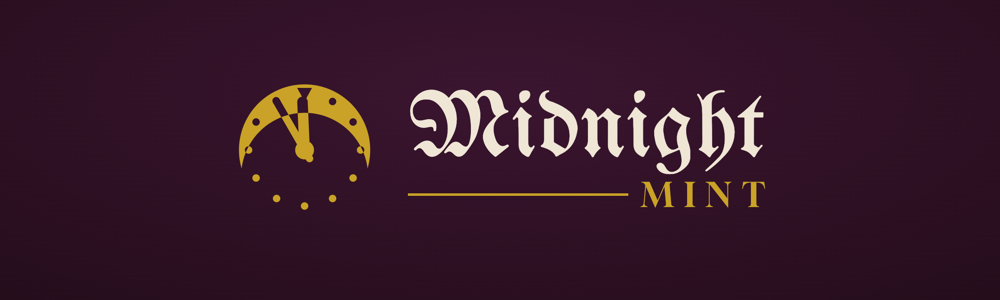
</p>

<p align="center">
  Design 3D-printable character tokens for <em>Blood on the Clocktower</em>, preview them in 3D,<br>
  and send them straight to your printer, or print them on paper.
</p>

<p align="center">
  <a href="https://midnight-mint.web.app"><strong>Open the app</strong></a>
  ·
  <a href="#license-and-credits">License and credits</a>
</p>

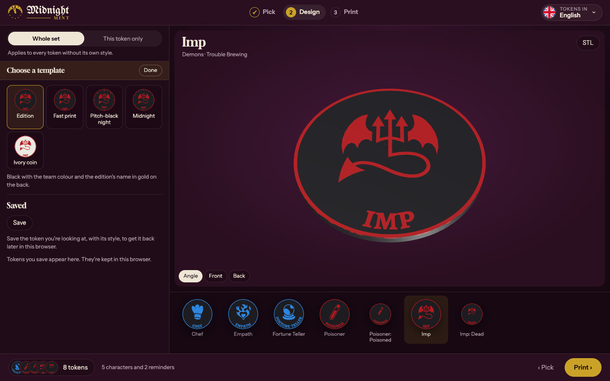

<p align="center"></p>

<p align="center">
  Midnight Mint is a free, community-made tool. It is not affiliated with or endorsed by
  The Pandemonium Institute.<br>No account needed: open it and start designing.
</p>

## Features

**Find your tokens**
- Every character and reminder token of each edition, in English or in 12 community translations from
  [Villacuervos](https://villacuervos.es): six Spanish ones, Asturian, Catalan, Valencian, Basque, Galician
  and Portuguese. Where a translation has them, characters can also take their feminine form.
- Search by character or reminder text, and filter by team.
- Add a whole edition (or whatever is on screen) to the print queue in one click, with or without its reminders.
- Keep your own **scripts**: import the Script Tool's JSON and the script sits beside the editions.
  Scripts live in your browser; share one with a link (the script travels inside it) or download it as JSON.

| Token language | A shared script |
|---|---|
| 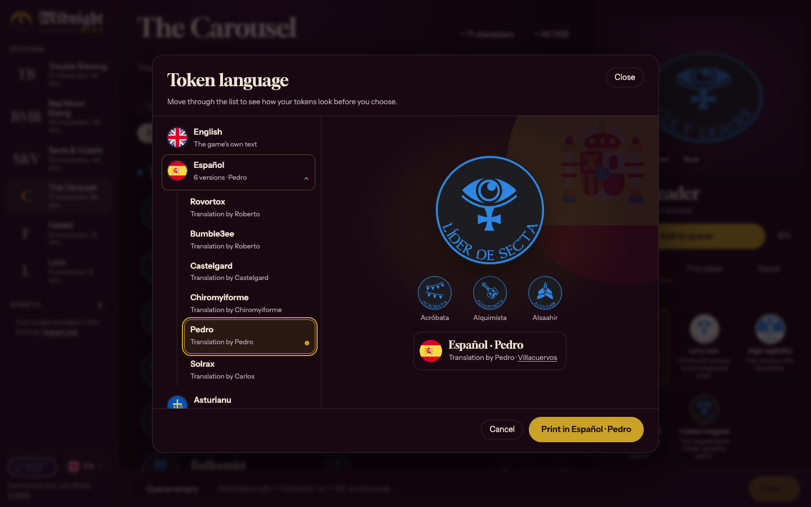 | 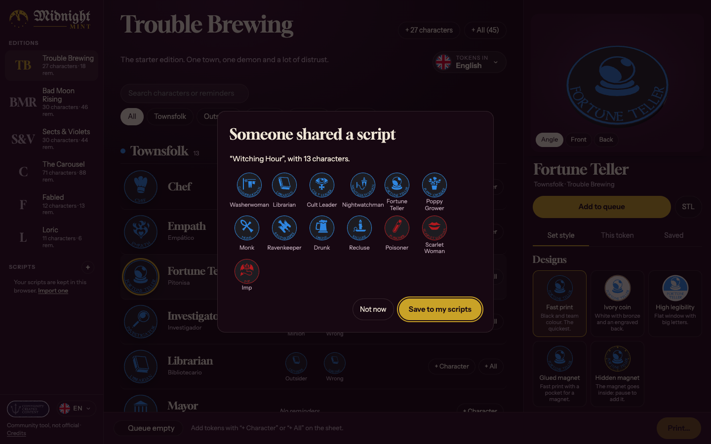 |

**Design them**
- Ready-made designs to start from: *Fast print*, *Ivory coin*, *High legibility*, *Glued magnet* and *Hidden magnet*.
- Two layouts: **classic** (name curved along the edge) and **window** (a framed picture with a straight name).
  The window can be flat, so nobody can feel which character they drew.
- 9 frame designs, and 6 back designs plus the edition's name or your own SVG, each drawn on your character as you choose.
- Any of the 10 filament colours for the coin, the frame and the back; the name and icon take the team colour.
- A live 3D preview you can turn around, with front and back views.
- Style the whole set at once, or give a single token its own look, and save designs in your browser.

| Frames | Backs |
|---|---|
| 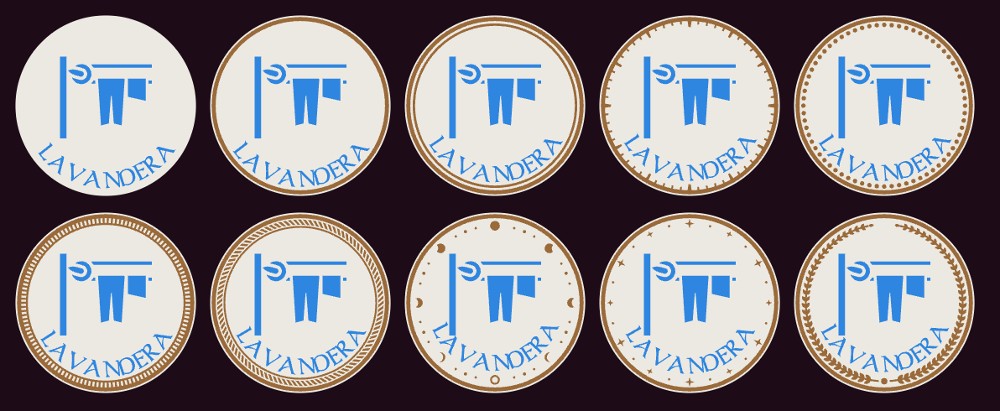 | 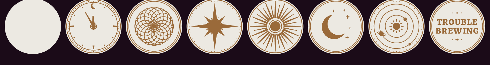 |

**Add magnets**
- **Back pocket**: an open hole in the centre of the back, to glue a magnet into after printing.
- **Hidden magnet**: a sealed cavity inside the coin. The printer pauses at exactly the right layer so you can drop the magnet in.
- Eight common magnet sizes. The coin gets thicker automatically when the magnet needs it, and an **X-ray** view shows where the magnet sits.

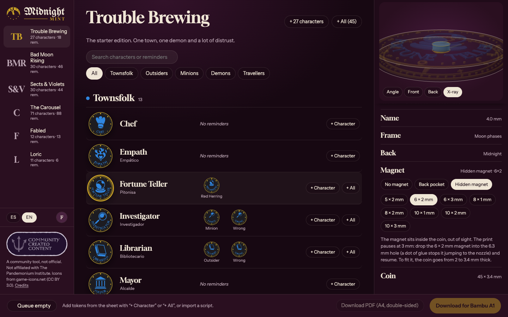

**Info tokens**
- The **Grimoire** edition has the 10 info tokens the Storyteller shows players ("This is the Demon", "You are"…)
  as 85 × 55 mm cards, in the set's colours and frame. English is the game's wording; Spanish is the app's own.
  They print like the coins: 8 a plate on the A1, 2 on the A1 mini, 8 an A4 sheet.

**Print them**
- Three steps: **pick** the tokens (tap them, add copies), **design** them (one design for the set, or one of
  their own), then **print**: see the plates (with their filaments) or the A4 sheets before you download.
- **Bambu Lab A1 or A1 mini, with AMS lite**: download a ready-to-print `.3mf`. Every part already has its filament,
  tokens are grouped onto plates by team with at most 4 colours each, and hidden magnets come with their pause.
  The A1 mini's smaller plate holds 8 characters or 14 reminders (the A1: 24 and 34). Choose the nozzle too:
  the standard 0.4 mm, or 0.2 mm for finer lettering (0.10 mm layers, slower). Before you download, each
  plate shows its estimated filament and time (calibrated against Bambu Studio), and names too small to print are flagged.
- **Any other printer**: download a token's STL files from the workshop, one per colour, with instructions.
- **Paper**: download a double-sided A4 PDF at real size. Each back lands behind its front, with cut guides.

| The queue | 3D printer | Paper |
|---|---|---|
| 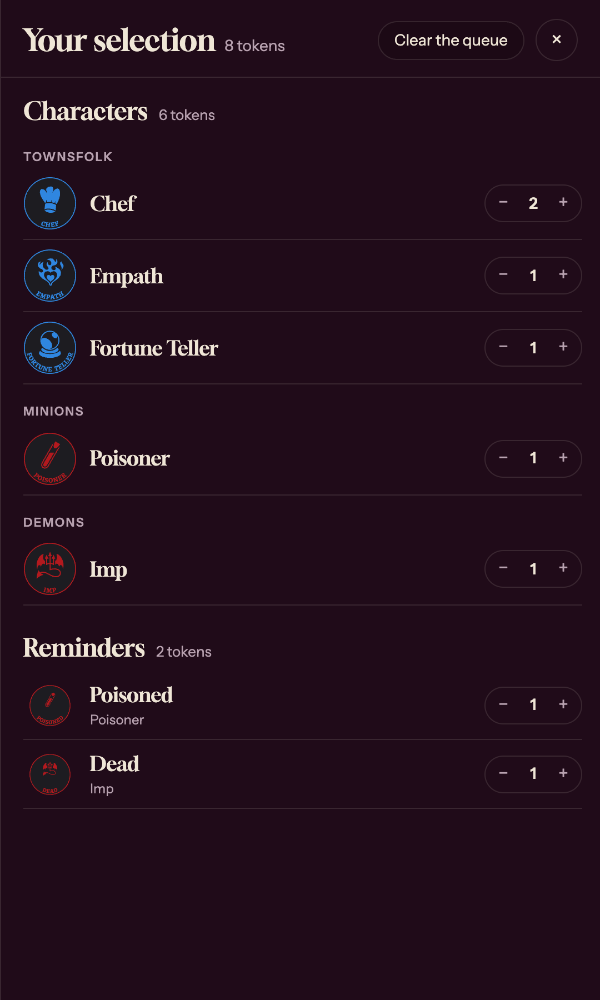 | 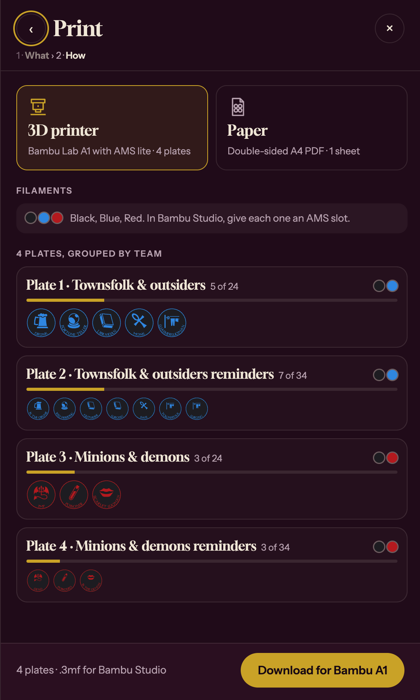 | 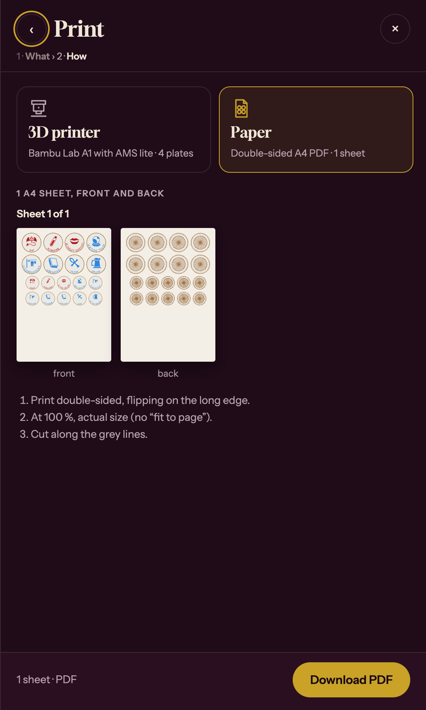 |

| PDF, fronts | PDF, backs |
|---|---|
| 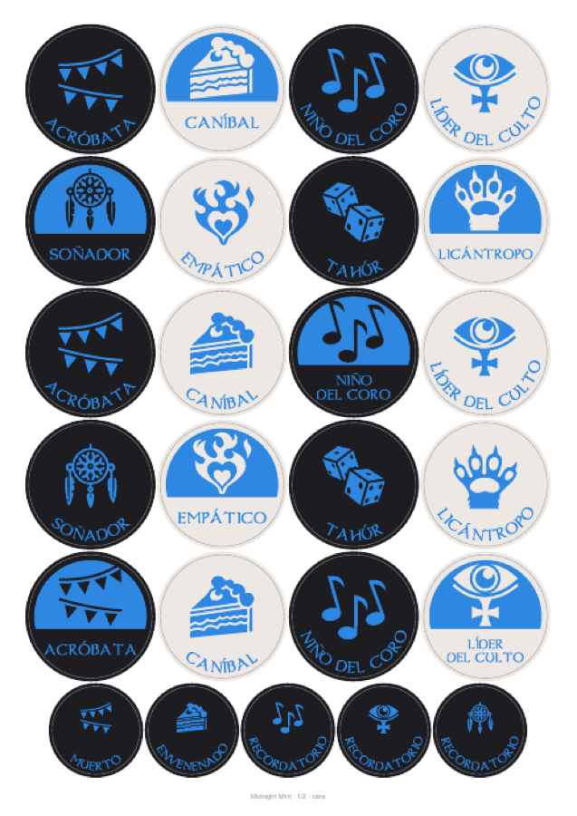 | 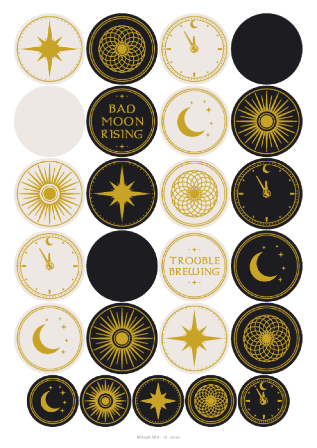 |

It also works on phones: the sidebar becomes a menu, and the top bar steps between editions.

<p align="center">
  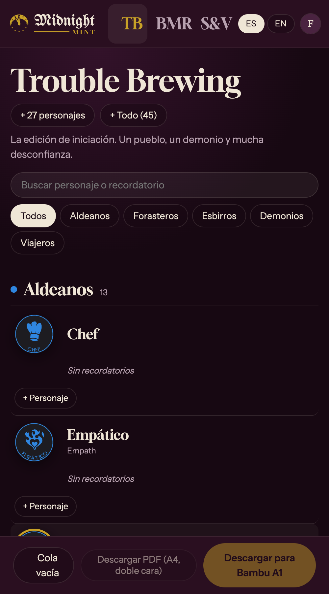
  &nbsp;
  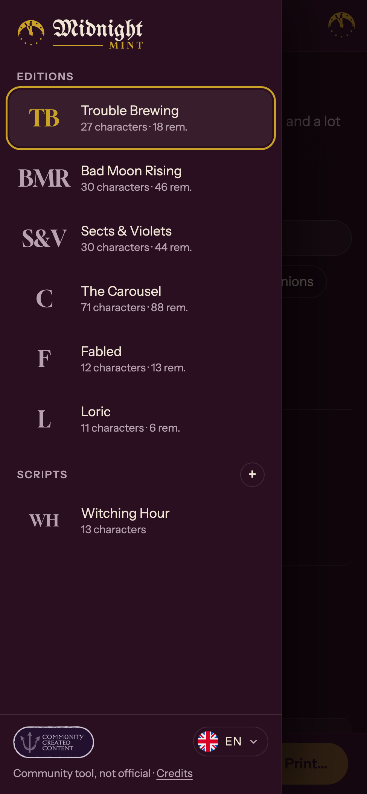
</p>

## Running it locally

```bash
npm install
npm run dev        # local dev server (needs the Firebase project)
npm run build      # production build in dist/
npm run deploy     # build, then deploy hosting and Firestore rules
```

To work on the interface without Firebase, run the test server. It uses a mocked sign-in
and the character library in `admin-data/`:

```bash
npx vite --config tools/ui-test/vite.config.js   # http://localhost:5198
```

The character library lives in Firestore. `admin-data/` (not in git) holds the source files;
`node tools/fetch-translations.mjs` adds the Villacuervos translations to `admin-data/roles_game_icons.json`,
and `node tools/upload-library.mjs` replaces the library with it.

## How it's put together

- `src/engine/token-engine.js`: the token geometry (three.js), the 3D viewer, 2D thumbnails and STL export.
  A token is a coin plus flush coloured inlays (name and icon, frame, back), so each colour is its own part.
- `src/bambu/bambu3mf.js`: the Bambu Studio project writer (plates, filaments, prime tower, magnet pauses).
  Its printer settings come from one template per printer and nozzle (`a1`, `a1mini`, and `-n02` for 0.2 mm),
  generated with Bambu Studio by `tools/make_bambu_template.py <any.stl> [a1|a1mini|a1-n02|a1mini-n02]`. On top of
  them it asks for Arachne walls and first-layer lines at the nozzle's normal width (the lettering is the first
  layer), a denser prime tower on the 0.2 mm nozzle so it keeps to its space, prints each plate's inlay colours
  before the coin's,
  and purges what Bambu Studio's own auto-calculation gives for each pair of colours plus 20 %
  (`src/bambu/flush.json`, from `tools/make_flush_table.py`).
- `src/pdf/print-pdf.js`: the double-sided A4 PDF, loaded only when you ask for it.
- `src/main.js`, `src/i18n.js`, `src/style.css`: the app, its Spanish and English text, and its look.
- `src/translations.js`: the languages tokens can be printed in, and who translated each one.
- `src/firebase.js`, `firestore.rules`: the public character library. Only the admin signs in (open the app with `?admin`) to upload it.
- `tools/`: test pages and helpers (UI test server, design sheets, icon review, Bambu template).

## License and credits

**Midnight Mint's code** is licensed under the
[PolyForm Noncommercial License 1.0.0](LICENSE). You may use, copy, modify and share it
for any **noncommercial** purpose, as long as you keep the license and its copyright notice.
Selling it, or using it to make money, is not allowed.

That license covers only the code written for this project. Everything below belongs to its owners
and keeps its own terms:

- ***Blood on the Clocktower*** and its character names, editions and rules belong to
  [The Pandemonium Institute](https://bloodontheclocktower.com). Midnight Mint is an unofficial fan tool,
  not affiliated with or endorsed by them. It uses none of the game's original artwork.
- **Translations** of character names and reminders come from [Villacuervos](https://villacuervos.es)
  and belong to their translators. Spanish: Roberto (the Rovortox and Bumble3ee versions), Castelgard,
  Chiromyiforme, Pedro and Carlos (Solrax). Asturian: Hugo. Catalan: Ren. Valencian: Carlos. Basque: JUMA.
  Galician: Dumis. Portuguese: uriell.
- **Character icons** come from [game-icons.net](https://game-icons.net) under
  [CC BY 3.0](https://creativecommons.org/licenses/by/3.0/). Each icon's author is credited in the app
  (*Credits*, at the bottom of the sidebar).
- **Language flags** come from [circle-flags](https://github.com/HatScripts/circle-flags) (MIT).
- **Fonts**: the token lettering is Alegreya SC ExtraBold by Juan Pablo del Peral (Huerta Tipográfica),
  under the SIL Open Font License (`public/AlegreyaSC-OFL.txt`); it was picked for strokes a 0.4 mm nozzle
  can print. Gloock, Instrument Sans and UnifrakturMaguntia are also under the OFL, served by Google Fonts.
  Dumbledor 1 (© GeM), the earlier lettering, is still in `public/` for the design prototypes in `tools/`.
- **Libraries**: [three.js](https://threejs.org) (MIT), [Firebase](https://firebase.google.com) (Apache 2.0),
  [JSZip](https://stuk.github.io/jszip/) (MIT or GPLv3), [jsPDF](https://github.com/parallax/jsPDF) (MIT)
  and [svg2pdf.js](https://github.com/yWorks/svg2pdf.js) (MIT).
