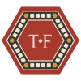
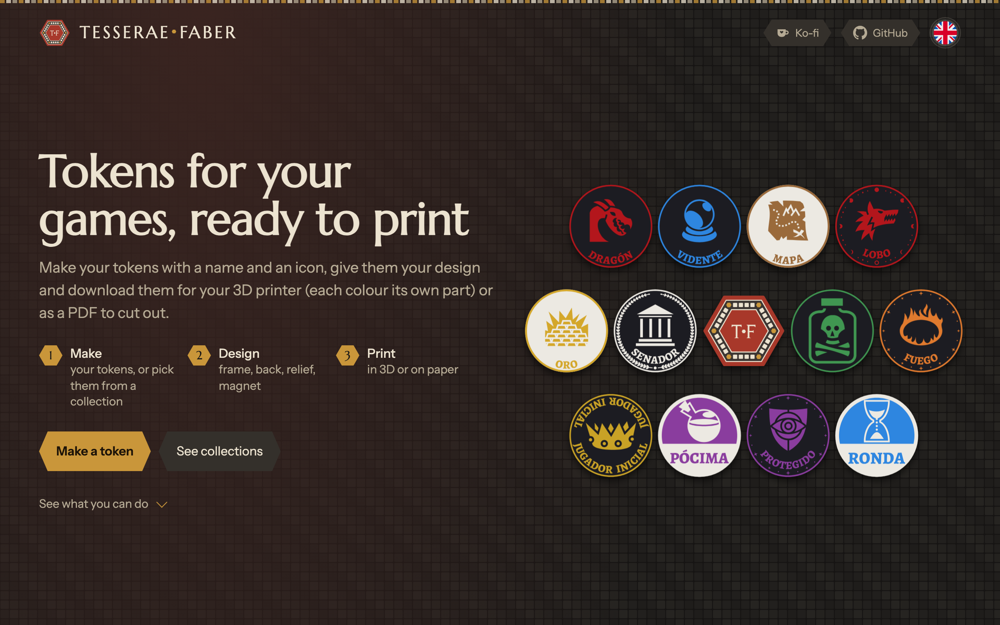

  

<h1 align="center">Tesserae Faber</h1>

  <strong>Tokens for your games, ready to print.</strong> 
  Make your tokens with a name and an icon, give them your design and download them 
  for your 3D printer (each colour its own part) or as a PDF to cut out.

  <a href="https://tesserae-faber.web.app"><strong>Open the app</strong></a>
  ·
  <a href="#license-and-credits">Credits</a>
  ·
  <a href="https://ko-fi.com/rexuswolf">Ko-fi</a>

  

## Make · Design · Print

1. **Make** your tokens, or pick them from a collection.
2. **Design** them: frame, back, relief, magnet.
3. **Print** them, in 3D or on paper.

## Make your tokens

Name each token and find its icon among the thousands on [game-icons.net](https://game-icons.net), or upload your own
SVG. Sort them into groups, each in its own colour.

Your tokens are kept in this browser, together in a collection you can give a name, a logo and colours. Export it to a
file to share it or carry on on another device.

**Or start from a ready collection**, with its tokens, its groups and designs made for it:

- ***El Senado***: a hidden-role game in Rome.
- ***5e Fantasy***: conditions, spells and markers.
- ***Draw Steel***: hero resources and conditions.

## Coins, cards, rings, bases and pieces

Not everything is a coin. A collection can have each kind, and each kind is designed and printed its own way.

| | |
|---|---|
| **Coins** | 30 to 60 mm |
| **Cards** | 85 × 55 mm, with their phrase, their icon and their back |
| **Rings** | slip round a miniature's base (25 to 50 mm), with its condition all the way round |
| **Bases** | trays the miniature's base sits in, with a number or a name on the tab |
| **Pieces** | solid playing pieces, printed lying down: an icon's silhouette (like a meeple, its outline grown by a margin, its holes filled) or a simple shape (circle, hexagon, square, octagon, triangle, diamond, star, heart), 15 to 60 mm and 2 to 12 mm thick, with the icon on top, on top and underneath, or none |

## Design them

A design sets how every token looks at once: colours, frame, lettering, back. Change something and the token changes
at once: what you see is what you'll print.

- Frames of all kinds: laurel, beads, runes, rope, Greek keys, waves, poker chip, arcs, moon phases…
- Background patterns, such as harlequin, scales or quartered.
- A raised name, frame or icon, to feel them by touch.
- A hole for a magnet, open or hidden inside.
- The back too: one for them all, so nobody can tell which token it is, or the token's other face, like a vote that
  says yes on one side and no on the other.

Your designs work in any collection: start one from scratch, from a collection's or from another of yours.

## Print them

- **Each colour, its own part**: a Bambu Studio project with the plates laid out and each part of the token on its
  filament. Open it, slice it and print. For the A1 and A1 mini with the AMS lite; any other printer gets STL files,
  one per colour.
- **Or on paper, to cut out**: an A4 PDF with the tokens at their real size, each back placed so that, printed
  double-sided, it lands behind its token.

## Free and open source

No accounts, no ads: your collections and designs stay in your browser. If you'd like to support the project, you can
do so on [Ko-fi](https://ko-fi.com/rexuswolf).

---

Developing it: see [docs/development.md](docs/development.md).

## License and credits

**Tesserae Faber's code** is licensed under the [PolyForm Noncommercial License 1.0.0](LICENSE): use, copy, modify
and share it for any **noncommercial** purpose, keeping the license and its copyright notice. That covers only the
code written for this project; everything below belongs to its owners and keeps its own terms.

- ***El Senado*** is based on [Secret Hitler](https://www.secrethitler.com) by Goat, Wolf & Cabbage (Max Temkin, Mike Boxleiter
  and Tommy Maranges), licensed [CC BY-NC-SA 4.0](https://creativecommons.org/licenses/by-nc-sa/4.0/). The adaptation
  (`public/collections/senado.json`) is shared under the same licence; it is unofficial and not affiliated with or
  endorsed by Goat, Wolf & Cabbage.
- ***5e Fantasy*** includes material from the System Reference Document 5.2 ("SRD 5.2") by Wizards of the Coast LLC, available at
  <https://www.dndbeyond.com/srd>, licensed under the
  [Creative Commons Attribution 4.0 International License](https://creativecommons.org/licenses/by/4.0/legalcode).
  The collection is unofficial and not affiliated with or endorsed by Wizards of the Coast.
- ***Draw Steel*** and its rules belong to [MCDM Productions](https://www.mcdmproductions.com). 
  Tesserae Faber is an independent product published under the DRAW STEEL Creator License and is not affiliated
  with MCDM Productions, LLC. DRAW STEEL © 2026 MCDM Productions, LLC.
- **Icons** come from [game-icons.net](https://game-icons.net) under [CC BY 3.0](https://creativecommons.org/licenses/by/3.0/);
  each icon's author is credited in the app (*About the tool*).
- **Language flags** come from [circle-flags](https://github.com/HatScripts/circle-flags) (MIT).
- **Fonts**: the token lettering is Alegreya SC ExtraBold by Juan Pablo del Peral (Huerta Tipográfica), under the
  SIL Open Font License (`public/AlegreyaSC-OFL.txt`). Marcellus, Gloock, Instrument Sans, Bricolage Grotesque and
  UnifrakturMaguntia are also under the OFL, served by Google Fonts. Dumbledor 1 (© GeM), the earlier lettering, is
  still in `public/` for the design prototypes.
- **Libraries**: [three.js](https://threejs.org) (MIT), [Firebase](https://firebase.google.com) (Apache 2.0),
  [JSZip](https://stuk.github.io/jszip/) (MIT or GPLv3), [jsPDF](https://github.com/parallax/jsPDF) (MIT),
  [svg2pdf.js](https://github.com/yWorks/svg2pdf.js) (MIT), [clipper-lib](https://sourceforge.net/projects/jsclipper/)
  (Boost Software License, the pieces' silhouettes) and [imagetracerjs](https://github.com/jankovicsandras/imagetracerjs) (public domain).
